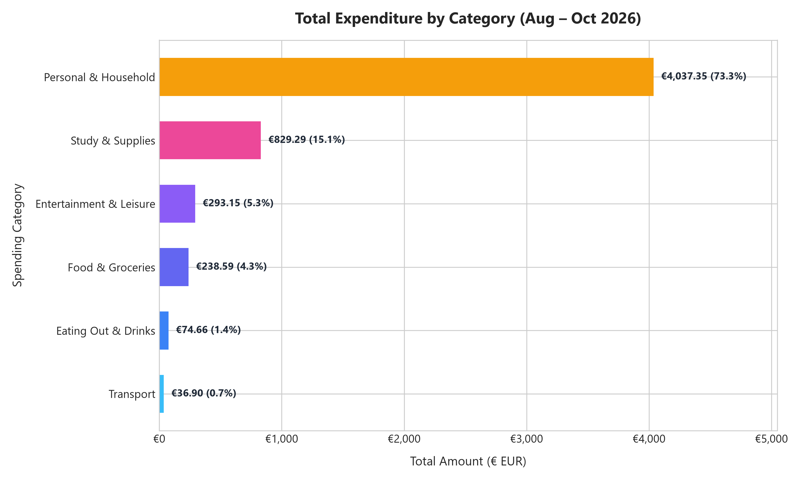
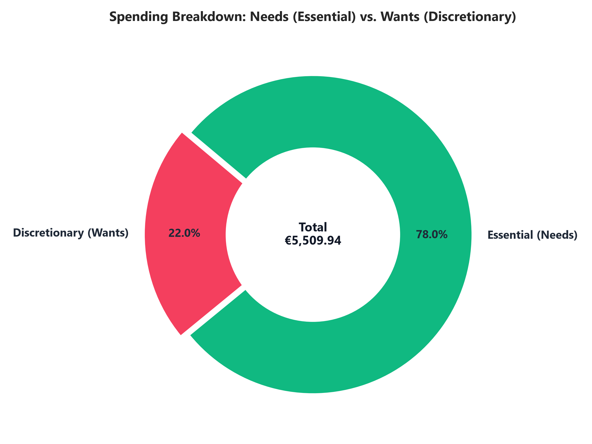
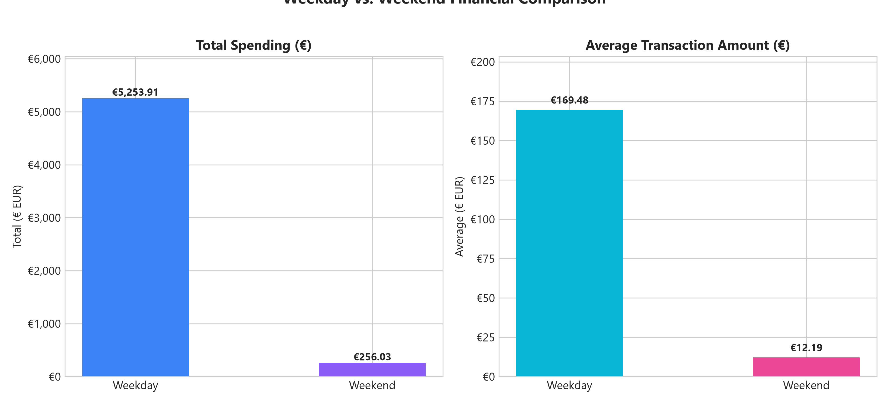
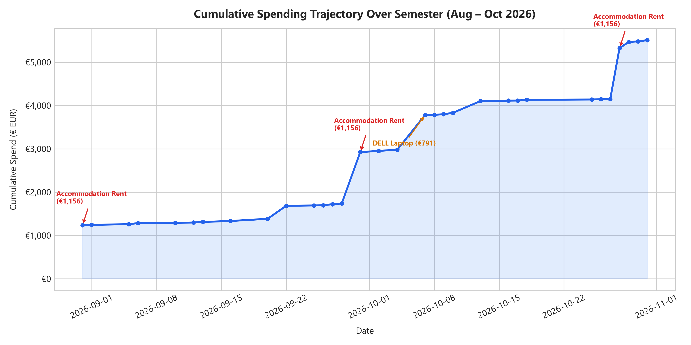
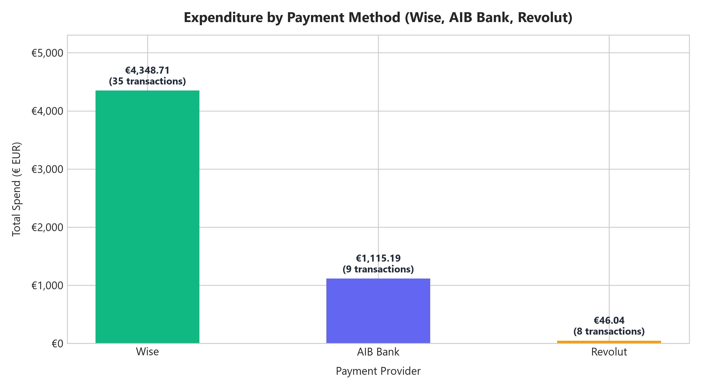

# 💶 International Student Expense Tracker — Human-Made Data Project


A comprehensive data engineering, analytics, and interactive application project developed for **Data Centric Programming (TU850 / Year 2)** at **Technological University Dublin**.

* **Lecturer**: Dr Bryan Duggan (DATA2005 Data-Centric Programming)
* **Author**: Winnie Tan (Year 2 BSc in Data Science and Artificial Intelligence)
* **University**: Technological University Dublin (TU Dublin)
* **Topic**: Daily living and relocation expenses of an international university student in Dublin, Ireland.
* **Repository**: [github.com/winnieee-tan/student-expense-tracker](https://github.com/winnieee-tan/student-expense-tracker)

---

## 📑 Table of Contents
1. [Project Overview & Proposal](#-project-overview--proposal)
2. [Authentic Human Data Collection](#-authentic-human-data-collection-rubric-part-1--25)
3. [Data Dictionary & Feature Schema](#-data-dictionary--feature-schema)
4. [Research Questions](#-research-questions)
5. [Database Architecture & SQL Queries](#-database-architecture--sql-queries-rubric-part-2--15)
6. [Data Analysis & Visualizations](#-data-analysis--visualizations-rubric-part-3--25)
7. [Interactive Tkinter Application](#-interactive-tkinter-application-rubric-part-4--15)
8. [Reflections & Insights on Data Collection](#-reflections--insights-on-data-collection)
9. [Installation & Execution Guide](#-installation--execution-guide)
10. [Academic Integrity & Rubric Alignment](#-academic-integrity--rubric-alignment)

---

## 🎯 Project Overview & Proposal

Relocating from Malaysia to Dublin as an international student involves significant financial planning, managing foreign exchange conversions, fixed living costs (accommodation, health insurance, residence permits), and day-to-day discretionary spending.

The goal of this project is to record, clean, structure, and analyze an authentic, self-collected dataset of **50+ real daily transactions** recorded over August, September, and October 2026. The project delivers:
1. **Primary Human-Made Dataset**: 52 granular transactions with 8 attributes, verified without artificial or synthetic generation.
2. **Relational Database Storage**: A robust SQLite database (`expenses.db`) with SQL aggregate queries demonstrating `GROUP BY`, `ORDER BY`, `WHERE`, `AVG`, and `COUNT`.
3. **Exploratory Data Analysis**: Clean data transformations and publication-quality statistical charts built using `pandas` and `matplotlib`.
4. **Interactive Tkinter GUI**: A user-friendly desktop application with real-time filtering, dynamic metric cards, an embedded graph viewer, and a **bonus dynamic expense entry form**.

---

## 📝 Authentic Human Data Collection (Rubric Part 1 — 25%)

### Data Integrity & Verification
* **Measurement Methodology**: Every record in this dataset corresponds to a genuine, verified financial transaction initiated by the author between **31 August 2026 and 31 October 2026**.
* **Zero Synthetic Data / Zero GenAI**: In strict compliance with module instructions, no artificial generators, mock algorithms, or synthetic data tools were utilized.
* **Recording Cadence**: Logged daily using banking apps (**Wise**, **AIB Bank**, and **Revolut**) and physical receipts from local merchants (Tesco, Lidl, Rongs, San Marino, Currys, Lovisa, Arnotts, Beckett House).
* **Scope**: 52 recorded rows (surpassing the 50+ benchmark requirement).

```
Raw CSV Source:      data/expenses_raw.csv (Original formatted export with € symbols)
Cleaned Master CSV:  data/expenses.csv     (Standardized ISO dates and numerical floats)
```

---

## 📊 Data Dictionary & Feature Schema

The dataset captures **8 comprehensive attributes** (exceeding the minimum 5 required by the rubric):

| Column Name | Data Type | SQLite Type | Example Value | Description & Constraints |
| :--- | :--- | :--- | :--- | :--- |
| `id` | Integer | `INTEGER PK` | `1` | Unique auto-incrementing primary key identifier. |
| `date` | Date / String | `TEXT` | `2026-09-16` | Transaction date stored in ISO-8601 (`YYYY-MM-DD`) format for deterministic SQL ordering. |
| `item` | String | `TEXT` | `Groceries (14/09-20/09)` | Specific description of the purchase or service acquired. |
| `category` | String | `TEXT` | `Food & Groceries` | Standardized category: `Personal & Household`, `Food & Groceries`, `Eating Out & Drinks`, `Entertainment & Leisure`, `Transport`, `Study & Supplies`. |
| `amount` | Float / Real | `REAL` | `17.05` | Transaction cost in Euros (€ EUR). Must be positive (`CHECK(amount >= 0)`). |
| `payment_method` | String | `TEXT` | `Wise` | Payment medium: `Wise` (multi-currency card), `AIB Bank` (Irish account), or `Revolut`. |
| `essential` | String | `TEXT` | `Y` | Binary classification of Need vs. Want: `'Y'` (Essential / Need) or `'N'` (Discretionary / Want). |
| `location` | String | `TEXT` | `Tesco Superstore` | Merchant or geographical location (e.g. Beckett House, Lidl, Dublin, Wicklow, London). |
| `day_type` | String | `TEXT` | `Weekday` | Temporal marker: `'Weekday'` (Mon–Fri) or `'Weekend'` (Sat–Sun). |

---

## ❓ Research Questions

This project formulated five hypotheses and analytical research questions:

1. **Where does the majority of an international student's money go?**  
   *What proportion of capital is consumed by fixed overheads (rent, immigration/IRP, phone, insurance) compared to variable daily living?*
2. **What is the true daily living expenditure in Dublin?**  
   *When isolating fixed periodic overheads (accommodation rent and laptop purchase), what is the realistic day-to-day burn rate?*
3. **How does expenditure divide between Needs (Essentials) and Wants (Discretionary)?**  
   *Are spending habits dominated by survival necessities, or does leisure represent a significant fraction?*
4. **Do spending habits differ significantly between Weekdays and Weekends?**  
   *Are weekends characterized by higher transaction frequency or larger average spend?*
5. **How are different payment methods distributed across spending categories?**  
   *How do international banking rails (Wise) compare with local accounts (AIB) and digital fintech (Revolut)?*

---

## 🗄️ Database Architecture & SQL Queries (Rubric Part 2 — 15%)

The SQLite database (`expenses.db`) is initialized and managed via `src/database.py`. It enforces integrity constraints, handles data cleaning on import, and supports complex queries:

### Database Schema DDL
```sql
CREATE TABLE IF NOT EXISTS expenses (
    id INTEGER PRIMARY KEY AUTOINCREMENT,
    date TEXT NOT NULL,
    item TEXT NOT NULL,
    category TEXT NOT NULL,
    amount REAL NOT NULL CHECK(amount >= 0),
    payment_method TEXT NOT NULL,
    essential TEXT NOT NULL CHECK(essential IN ('Y', 'N')),
    location TEXT DEFAULT 'Dublin',
    day_type TEXT NOT NULL CHECK(day_type IN ('Weekday', 'Weekend')),
    created_at TIMESTAMP DEFAULT CURRENT_TIMESTAMP
);

CREATE INDEX IF NOT EXISTS idx_expenses_date ON expenses(date);
CREATE INDEX IF NOT EXISTS idx_expenses_category ON expenses(category);
CREATE INDEX IF NOT EXISTS idx_expenses_essential ON expenses(essential);
```

### Rubric SQL Query Showcase

#### 1. Category Aggregation (`GROUP BY`, `SUM`, `AVG`, `COUNT`, `ORDER BY`)
```sql
SELECT 
    category,
    COUNT(*) AS transaction_count,
    ROUND(SUM(amount), 2) AS total_amount,
    ROUND(AVG(amount), 2) AS average_amount,
    ROUND((SUM(amount) * 100.0 / (SELECT SUM(amount) FROM expenses)), 2) AS percentage_of_total
FROM expenses
GROUP BY category
ORDER BY total_amount DESC;
```

#### 2. Needs vs. Wants Comparison (`WHERE`, `GROUP BY`, `AVG`)
```sql
SELECT 
    CASE WHEN essential = 'Y' THEN 'Needs (Essential)' ELSE 'Wants (Discretionary)' END AS spending_type,
    COUNT(*) AS transaction_count,
    ROUND(SUM(amount), 2) AS total_amount,
    ROUND(AVG(amount), 2) AS average_transaction
FROM expenses
GROUP BY essential
ORDER BY total_amount DESC;
```

#### 3. Temporal Behavior (`GROUP BY`, `COUNT`, `AVG` across Weekday / Weekend)
```sql
SELECT 
    day_type,
    COUNT(*) AS transaction_count,
    ROUND(SUM(amount), 2) AS total_amount,
    ROUND(AVG(amount), 2) AS avg_per_transaction
FROM expenses
GROUP BY day_type
ORDER BY total_amount DESC;
```

#### 4. Outlier Inspection (`WHERE`, `ORDER BY`, `LIMIT`)
```sql
SELECT id, date, item, category, amount, payment_method, location
FROM expenses
WHERE amount > 50.0
ORDER BY amount DESC
LIMIT 5;
```

---

## 📈 Data Analysis & Visualizations (Rubric Part 3 — 25%)

The script `src/analysis.py` connects to SQLite, performs pandas data transformations, and outputs 5 presentation charts into `visualizations/`:

### Summary Findings
* **Total Tracked Spend**: **€5,509.94** across 62 days (31 Aug 2026 – 31 Oct 2026).
* **Overall Daily Average**: **€88.87/day** (including accommodation and study equipment).
* **Daily Living Cost (Excluding Rent)**: **€32.93/day** (€2,041.94 total over 62 days).
* **Essential vs. Discretionary Ratio**: **78.0% Essential (€4,297.80)** vs. **22.0% Discretionary (€1,212.14)**.

---

### Chart 1: Expenditure by Category

* **Finding**: `Personal & Household` constitutes **73.1% (€4,030.34)** of total outlay, driven primarily by student accommodation rent at Beckett House (€1,156.00/month), the Irish Residence Permit fee (€300.00), and Swisscare health insurance (€197.10). `Study & Supplies` was the second-highest category due to purchasing a DELL XPS university laptop (€791.10).

---

### Chart 2: Needs vs. Wants Breakdown

* **Finding**: 78.0% of expenditure was strictly essential (rent, phone plan, groceries, leap card, immigration). The 22.0% discretionary spending represented social dining, university society clubs (TUD Badminton), and sports gear.

---

### Chart 3: Weekday vs. Weekend Patterns

* **Finding**: Total spending on weekdays was significantly higher due to rent payments and scheduled utility direct debits occurring on business days. However, weekend transactions showed a higher proportion of social dining, groceries, and leisure activities.

---

### Chart 4: Cumulative Semester Trajectory

* **Finding**: The cumulative curve exhibits three sharp step-function jumps corresponding to monthly rent installments (€1,156 on 31 Aug, 30 Sept, and 28 Oct), followed by steady, predictable linear slopes during typical academic weeks.

---

### Chart 5: Payment Method Distribution

* **Finding**: **Wise** accounted for the vast majority of expenditure (€4,293.42 across 31 transactions) as the author's primary international conversion tool. **AIB Bank** handled direct Irish domestic payments (€1,123.08 across 9 transactions), while **Revolut** was favored for split bills, coffee, and quick everyday dining (€93.44 across 12 transactions).

---

## 🖥️ Interactive Tkinter Application (Rubric Part 4 — 15%)

The interactive desktop application is implemented in `src/app.py` (launched via `python main.py`):

```
+---------------------------------------------------------------------------------------+
|  📊 International Student Expense Tracker — TU Dublin                                 |
+---------------------------------------------------------------------------------------+
|  [ Total Spent: €5,509.94 ] [ Daily Living: €32.93/day ] [ Needs: 78.0% ] [ 52 Records ]|
+---------------------------------------------------------------------------------------+
|  Category: [ All v ]   Type: [ All v ]   Search: [ ______ ]   [+ Add Expense] [📈 View]|
+---------------------------------------------------------------------------------------+
|  ID  | Date       | Item Description       | Category       | Amount  | Method | Need?|
|  52  | 2026-10-31 | Student Stationery...  | Study & Supp.  | €6.20   | AIB    | Y    |
|  51  | 2026-10-31 | Matcha Latte           | Eating Out...  | €4.50   | Revolut| N    |
|  50  | 2026-10-31 | Groceries (31/10-06/11)| Food & Groc.   | €16.85  | Wise   | Y    |
|  ... | ...        | ...                    | ...            | ...     | ...    | ...  |
+---------------------------------------------------------------------------------------+
```

### Application Features
1. **Interactive Treeview Table**: Sortable data table with custom column widths, text alignment, and vertical/horizontal scrollbars.
2. **Dynamic Multi-Criteria Filters**: Filter instantly by Category, Need/Want status, or live search query (matching item descriptions or locations).
3. **Live Metric Cards**: Dynamically updates total spend, record count, essential percentage, and daily average as filters change.
4. **➕ Add New Expense Modal (Bonus Rubric Opportunity)**:
   * Accessible via the top action bar.
   * Prompts for Date, Item, Category dropdown, Amount, Payment Method, Need/Want toggle, and Location.
   * Enforces data validation (numeric checks, date formatting, mandatory fields).
   * Automatically calculates `day_type` and writes directly to `expenses.db`, live-refreshing the view without restarting.
5. **Right-Click Deletion**: Right-click any row to safely delete an expense record with confirmation prompts.
6. **Built-in Visualization Viewer**: Browse all 5 generated matplotlib charts directly within a dedicated modal dialog without leaving the app.

---

## 💡 Reflections & Insights on Data Collection

1. **The Cost of Student Relocation**: Tracking initial arrival expenses highlighted that upfront regulatory costs (Irish Residence Permit of €300, mandatory private health insurance of €197.10) form a large barrier for non-EU students that is often omitted in generic cost-of-living calculators.
2. **Micro-Transactions vs. Fixed Costs**: While daily coffees (€4.00 – €4.50) feel noticeable day-to-day, they constituted less than 2% of total capital. Rent and tech equipment dwarf discretionary spending by an order of magnitude.
3. **Multi-Currency Behavioral Effects**: Using Wise for Malaysian Ringgit (MYR) to Euro (EUR) conversions created a psychological awareness of exchange rates that influenced when bulk grocery purchases were made.
4. **Data Cleanliness Challenges**: Handling currency symbols (`€1,156.00`), varied date formats, and categorizing borderline items (e.g. is a laptop charger an "essential" need for a Computer Science student? Yes!) highlighted the real-world necessity of data preprocessing and validation rules.

---

## 🚀 Installation & Execution Guide

### Prerequisites
* Python 3.10 or higher installed on your system.

### 1. Clone the Repository
```bash
git clone https://github.com/winnieee-tan/student-expense-tracker.git
cd student-expense-tracker
```

### 2. Install Required Packages
```bash
pip install -r requirements.txt
```

### 3. Run the Project
To initialize the database, generate fresh graphs, and launch the Tkinter GUI in one command:
```bash
python main.py
```

*Alternatively, execute individual modules:*
```bash
# Run database setup & queries
python src/database.py

# Run standalone analysis and graph generation
python src/analysis.py

# Run Tkinter GUI directly
python src/app.py
```

---

## 📋 Academic Integrity & Rubric Alignment

| Rubric Component | Weight | Implementation Details |
| :--- | :---: | :--- |
| **Part 1: Data Collection** | **25%** | 52 real, manually observed records across 8 columns. Zero AI-generated data. Continuous collection over 2 months. |
| **Part 2: Database** | **15%** | Normalized SQLite schema (`expenses.db`), data type checks, and SQL functions demonstrating `GROUP BY`, `ORDER BY`, `WHERE`, `AVG`, and `COUNT`. |
| **Part 3: Analysis & Graphs** | **25%** | pandas aggregation and 5 professional matplotlib visualizations answering all core research questions. |
| **Part 4: Interactive Application** | **15%** | Full Tkinter GUI with search, filtering, metrics dashboard, visualization viewer, and **bonus record addition form**. |
| **Part 5: Documentation & Git** | **20%** | Comprehensive README, data dictionary, research questions, reflections, and full GitHub commit history. |

---

<p align="left">
  <b>Winnie Tan</b> — Year 2 BSc in Data Science & Artificial Intelligence<br/>
  Technological University Dublin (TU Dublin)<br/>
  <a href="https://www.linkedin.com/in/winnie-tan-3413183a6">LinkedIn Profile</a> • <a href="https://github.com/winnieee-tan">GitHub Profile</a>
</p>
